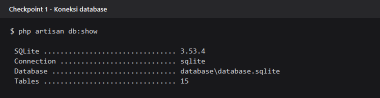
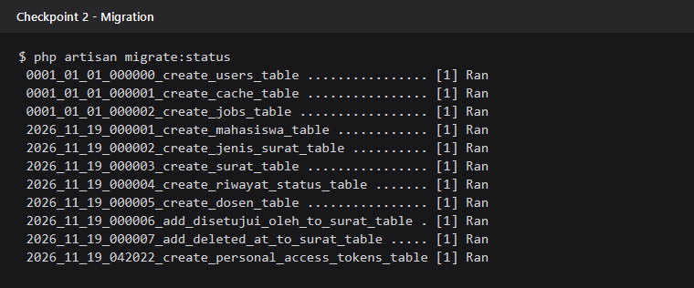
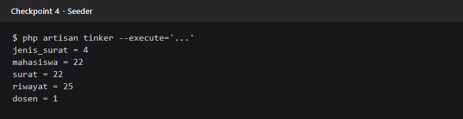
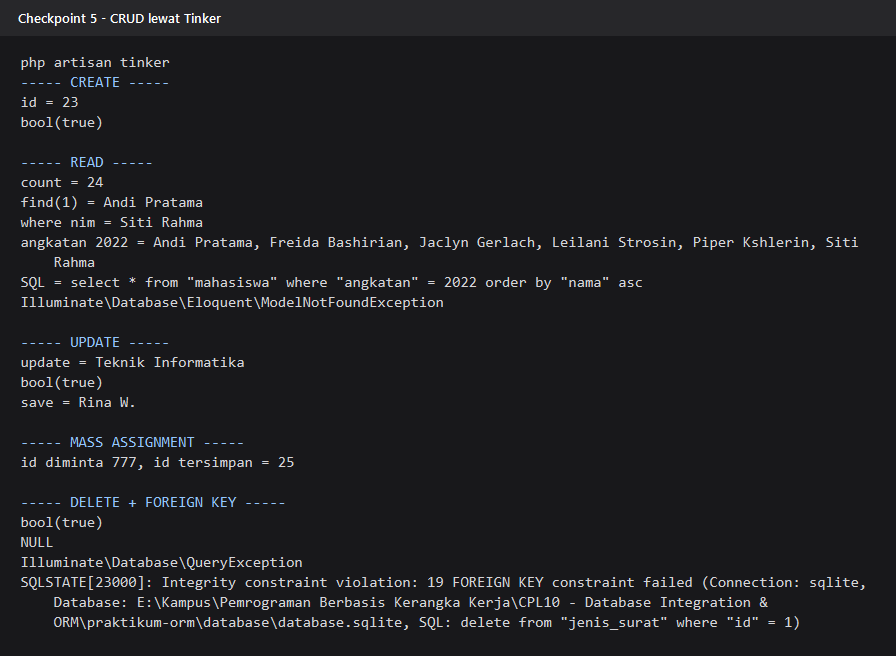
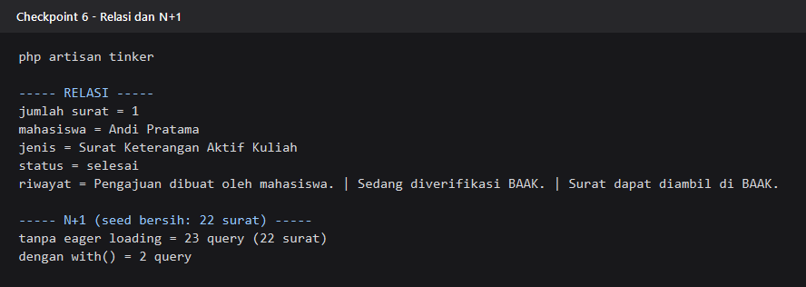
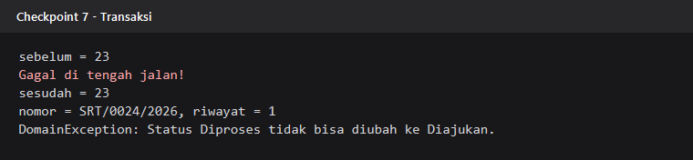
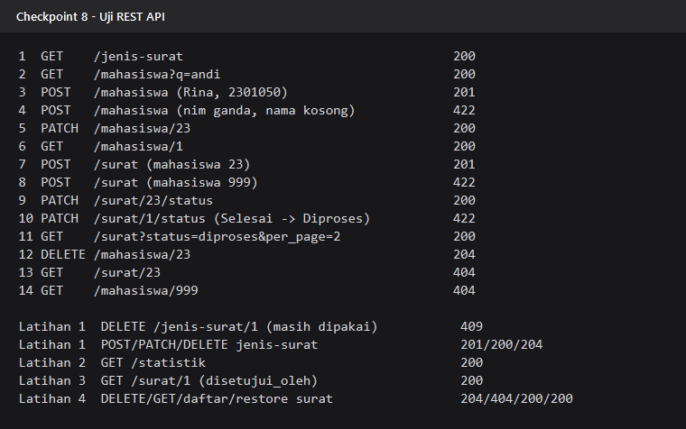
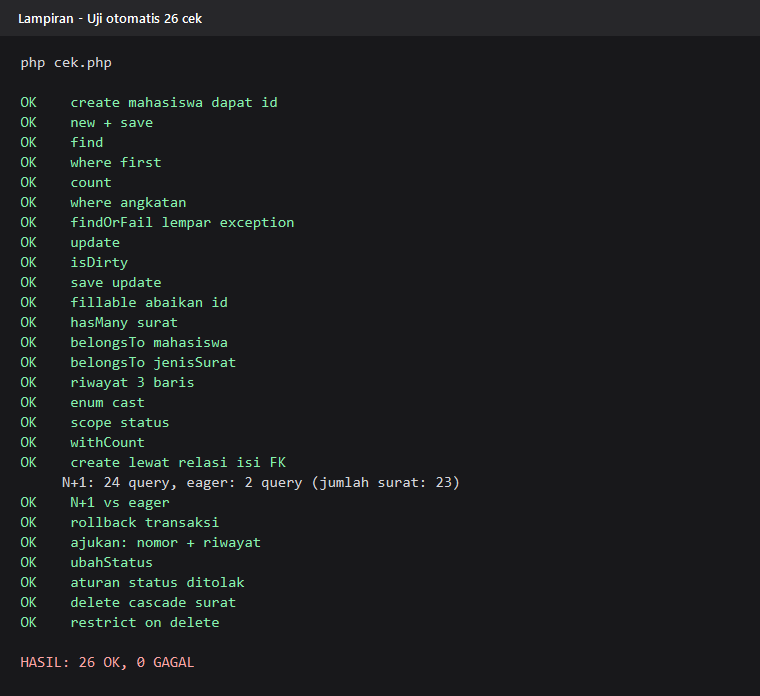

# Laporan Praktikum — Database Integration & ORM

**Mata kuliah:** IF T5251P Pemrograman Berbasis Kerangka Kerja  
**Pertemuan:** 9 — Database Integration & ORM  
**CPL:** CPL10 — solusi berbasis computing multi-platform  
**CPMK:** CPMK101 [C3] — integrasi database dan ORM pada sisi server  
**Indikator:** CRUD ke database menggunakan ORM framework

| Keterangan | Isi |
| --- | --- |
| Nama | Jefanya Efandchris |
| NIM | 2443047 |
| Repositori | https://github.com/jefa2231/praktikum-orm |
| Tanggal | 19 November 2026 |

## 1. Lingkungan pengujian

| Komponen | Versi |
| --- | --- |
| PHP | 8.5.12 (ZTS, Windows x64) |
| Laravel | 13.43.0 |
| Composer | 2.11.2 |
| Database | SQLite 3.53.4 (`database/database.sqlite`) |
| Ekstensi PHP | pdo_sqlite, sqlite3, openssl, mbstring, curl, fileinfo, intl, zip |

Perintah yang dijalankan:

```bash
composer create-project laravel/laravel praktikum-orm
php artisan install:api
php artisan migrate:fresh --seed
php artisan serve --host=127.0.0.1 --port=8009
```

## 2. Skema database

Empat tabel inti dari modul, ditambah satu tabel untuk Latihan 3:

| Tabel | Kolom penting | Foreign key / aturan |
| --- | --- | --- |
| `mahasiswa` | id, nim UNIQUE, nama, prodi, angkatan | — |
| `jenis_surat` | id, kode UNIQUE, nama | — |
| `surat` | id, nomor UNIQUE NULL, mahasiswa_id, jenis_surat_id, keperluan, status, disetujui_oleh, deleted_at | mahasiswa → **cascade**, jenis_surat → **restrict**, dosen → **null**, soft delete |
| `riwayat_status` | id, surat_id, status, catatan | surat → **cascade** |
| `dosen` | id, nidn UNIQUE, nama | — |

Migration dijalankan berurutan: tabel induk (`mahasiswa`, `jenis_surat`, `dosen`) lebih dulu,
baru tabel anak (`surat`, `riwayat_status`), lalu migration perubahan kolom.

## 3. Bukti checkpoint

### Checkpoint 1 — koneksi database

```text
$ php artisan db:show

 SQLite ................................ 3.53.4
 Connection ............................ sqlite
 Database .............................. database\database.sqlite
 Tables ................................ 15
```



*Gambar 1. Koneksi SQLite dan daftar tabel.*

### Checkpoint 2 — migration

```text
$ php artisan migrate:status
 0001_01_01_000000_create_users_table ................ [1] Ran
 0001_01_01_000001_create_cache_table ................ [1] Ran
 0001_01_01_000002_create_jobs_table ................. [1] Ran
 2026_11_19_000001_create_mahasiswa_table ............ [1] Ran
 2026_11_19_000002_create_jenis_surat_table .......... [1] Ran
 2026_11_19_000003_create_surat_table ................ [1] Ran
 2026_11_19_000004_create_riwayat_status_table ....... [1] Ran
 2026_11_19_000005_create_dosen_table ................ [1] Ran
 2026_11_19_000006_add_disetujui_oleh_to_surat_table . [1] Ran
 2026_11_19_000007_add_deleted_at_to_surat_table ..... [1] Ran
 2026_11_19_042022_create_personal_access_tokens_table [1] Ran
```



*Gambar 2. Semua migration berstatus Ran.*

### Checkpoint 3 — model & relasi

| Model | `$table` | `$fillable` | Relasi |
| --- | --- | --- | --- |
| `Mahasiswa` | `mahasiswa` | nim, nama, prodi, angkatan | hasMany `surat` |
| `JenisSurat` | `jenis_surat` | kode, nama | hasMany `surat` |
| `Surat` | `surat` | mahasiswa_id, jenis_surat_id, keperluan | belongsTo `mahasiswa`, `jenisSurat`, `disetujuiOleh`; hasMany `riwayat` |
| `RiwayatStatus` | `riwayat_status` | status, catatan | belongsTo `surat` |
| `Dosen` | `dosen` | nidn, nama | hasMany `surat` |

`Surat::casts()` memetakan kolom `status` ke enum `StatusSurat`; `Mahasiswa::casts()` memetakan
`angkatan` ke integer. `Surat` memakai trait `SoftDeletes`.

### Checkpoint 4 — factory & seeder

```text
$ php artisan tinker --execute='...'
jenis_surat = 4
mahasiswa = 22
surat = 22
riwayat = 25
dosen = 1
```

Sesuai modul: 4 jenis surat, 22 mahasiswa (2 contoh + 20 factory), 22 surat.



*Gambar 3. Jumlah data hasil seeder.*

### Checkpoint 5 — CRUD lewat Tinker

```text
----- CREATE -----
id = 23
bool(true)

----- READ -----
count = 24
find(1) = Andi Pratama
where nim = Siti Rahma
angkatan 2022 = Andi Pratama, Freida Bashirian, Jaclyn Gerlach, Leilani Strosin, Piper Kshlerin, Siti Rahma
SQL = select * from "mahasiswa" where "angkatan" = 2022 order by "nama" asc
Illuminate\Database\Eloquent\ModelNotFoundException

----- UPDATE -----
update = Teknik Informatika
bool(true)
save = Rina W.

----- MASS ASSIGNMENT -----
id diminta 777, id tersimpan = 25

----- DELETE + FOREIGN KEY -----
bool(true)
NULL
Illuminate\Database\QueryException
SQLSTATE[23000]: Integrity constraint violation: 19 FOREIGN KEY constraint failed
```

`id` yang dikirim lewat `create()` diabaikan karena tidak ada di `$fillable`. Penghapusan
`jenis_surat` yang masih dipakai ditolak database (foreign key `restrictOnDelete`).



*Gambar 4. Output Tinker untuk CRUD, mass assignment, dan foreign key (PHP 8.5.12 / Laravel 13.43.0 / SQLite).*

### Checkpoint 6 — relasi & N+1

```text
$ php artisan tinker --execute='...'
tanpa eager loading = 23 query (22 surat)
dengan with() = 2 query
```

23 = 1 query mengambil semua surat + 22 query mengambil mahasiswa satu per satu di dalam loop.
Dengan `with('mahasiswa')`, Eloquent menjalankan 2 query: satu untuk surat, satu
`select * from mahasiswa where id in (...)`.



*Gambar 5. Relasi dan perbandingan jumlah query sebelum/sesudah eager loading.*

### Checkpoint 7 — transaksi

```text
sebelum = 23
Gagal di tengah jalan!
sesudah = 23
nomor = SRT/0024/2026, riwayat = 1
DomainException: Status Diproses tidak bisa diubah ke Diajukan.
```

Jumlah surat tidak berubah setelah transaksi gagal, membuktikan rollback. `Surat::ajukan()`
menyimpan surat + nomor + riwayat dalam satu transaksi.



*Gambar 6. Rollback transaksi dan aturan transisi status.*

### Checkpoint 8 — REST API

Sepuluh skenario modul diuji dengan `curl` (header `Accept: application/json`):

| # | Request | Status | Hasil |
| --- | --- | --- | --- |
| 1 | `GET /api/v1/jenis-surat` | **200** | 4 jenis surat + `surat_count` |
| 2 | `GET /api/v1/mahasiswa?q=andi` | **200** | Andi, `surat_count: 1` |
| 3 | `POST /api/v1/mahasiswa` (Rina, 2301050) | **201** | `id: 23` |
| 4 | `POST /api/v1/mahasiswa` (NIM ganda, nama kosong, angkatan 1990) | **422** | 3 pesan validasi |
| 5 | `PATCH /api/v1/mahasiswa/23` | **200** | prodi berubah |
| 6 | `GET /api/v1/mahasiswa/1` | **200** | surat + jenis_surat |
| 7 | `POST /api/v1/surat` (mahasiswa 23) | **201** | `SRT/0023/2026`, 1 riwayat |
| 8 | `POST /api/v1/surat` (mahasiswa 999) | **422** | `exists:mahasiswa,id` gagal |
| 9 | `PATCH /api/v1/surat/23/status` | **200** | status `diproses`, 2 riwayat |
| 10 | `PATCH /api/v1/surat/1/status` | **422** | `Status Selesai tidak bisa diubah ke Diproses.` |
| 11 | `GET /api/v1/surat?status=diproses&per_page=2` | **200** | filter + paginasi |
| 12 | `DELETE /api/v1/mahasiswa/23` | **204** | cascade |
| 13 | `GET /api/v1/surat/23` | **404** | surat ikut terhapus |
| 14 | `GET /api/v1/mahasiswa/999` | **404** | route model binding |

Contoh respons nomor 7 (dipotong):

```json
{"data":{"status":"diajukan","mahasiswa_id":23,"jenis_surat_id":3,
"keperluan":"Penelitian skripsi di Diskominfo.","id":23,
"nomor":"SRT/0023/2026","mahasiswa":{"id":23,"nim":"2301050","nama":"Rina Wulandari"}}}
```

Contoh respons nomor 10:

```json
{"message":"Status Selesai tidak bisa diubah ke Diproses.",
 "errors":{"status":["Status Selesai tidak bisa diubah ke Diproses."]}}
```



*Gambar 7. Rekap status code seluruh skenario uji API dan latihan mandiri.*

## 4. Latihan mandiri

| Latihan | Implementasi | Bukti status |
| --- | --- | --- |
| 1. CRUD jenis surat + 409 | `JenisSuratController`, `Route::apiResource('jenis-surat')` | DELETE terpakai **409**; POST **201**; PATCH **200**; DELETE bebas **204** |
| 2. Statistik | closure `GET /statistik` dengan `selectRaw()->groupBy()->pluck()` dan `withCount('surat')` | **200**, `{"diajukan":20,"diproses":1,"selesai":1}` |
| 3. Dosen & persetujuan | tabel `dosen`, kolom `surat.disetujui_oleh` (`nullOnDelete`), relasi `disetujuiOleh()` | detail surat memuat `"disetujui_oleh":{"nidn":"0011223344","nama":"Dr. Budi Santoso, M.Kom."}` |
| 4. Soft delete (bonus) | `SoftDeletes`, `GET /surat/terhapus`, `POST /surat/{id}/restore` | DELETE **204** → GET **404** → daftar terhapus **200** → restore **200** |

Pesan 409:

```json
{"message":"Jenis surat masih dipakai oleh surat lain sehingga tidak bisa dihapus."}
```

Catatan desain: karena `Surat` memakai soft delete, pengecekan hapus jenis surat memakai
`withTrashed()->exists()` agar surat yang sudah di-soft-delete tetap dihitung dan database
tidak melempar error 500. Saat `Mahasiswa` dihapus, suratnya di-`forceDelete` lewat event
`deleting` supaya aturan `cascadeOnDelete` tetap berjalan.

## 5. Jawaban pertanyaan

### 5.1 Apa yang terjadi jika `protected $table = 'mahasiswa';` dihapus?

Laravel menebak nama tabel dari nama kelas dengan aturan **jamak bahasa Inggris**. Kelas
`Mahasiswa` diubah menjadi `mahasiswas`, sehingga query menunjuk tabel yang tidak ada:

```text
Illuminate\Database\QueryException
SQLSTATE[HY000]: General error: 1 no such table: mahasiswas
(Connection: sqlite, SQL: select count(*) as "aggregate" from "mahasiswas")
```

Nama tabel Indonesia berbentuk tunggal (`mahasiswa`), jadi `$table` harus ditulis eksplisit.
Masalah yang sama muncul pada foreign key bila `constrained('mahasiswa')` tidak ditulis.

### 5.2 Mengapa `status` dan `nomor` tidak dimasukkan ke `$fillable` model `Surat`?

Keduanya dikelola sistem, bukan input pengguna:

- `nomor` dibuat otomatis di `Surat::ajukan()` setelah `INSERT` karena membutuhkan `id`
  (`SRT/0023/2026`). Jika boleh diisi massal, pengguna bisa memalsukan nomor surat.
- `status` dimulai dari `diajukan` dan hanya boleh berubah lewat `ubahStatus()`, yang
  memvalidasi transisi (`Diajukan → Diproses → Selesai/Ditolak`). Jika masuk `$fillable`,
  `POST /surat` dengan `"status":"selesai"` akan melewati aturan bisnis dan riwayat status.

Dengan hanya `mahasiswa_id`, `jenis_surat_id`, dan `keperluan` di `$fillable`, mass assignment
dari request tidak bisa mengubah kolom sensitif. Data tetap harus berasal dari hasil validasi
(`$request->validate()`), bukan `$request->all()`.

### 5.3 Jelaskan dengan angka mengapa eager loading lebih efisien

Hasil percobaan pada 22 surat:

| Cara | Query | Rincian |
| --- | --- | --- |
| Lazy loading di loop | **23** | 1 `select * from surat` + 22 `select * from mahasiswa where id = ?` |
| `Surat::with('mahasiswa')` | **2** | 1 `select * from surat` + 1 `select * from mahasiswa where id in (...)` |

Jumlah query pada cara pertama adalah **1 + N** (N = jumlah surat). Dengan 10.000 surat menjadi
10.001 query; eager loading tetap **2** query berapa pun jumlah datanya. Semakin banyak baris,
selisih waktu dan beban database semakin besar. Relasi bertingkat dapat dimuat sekaligus dengan
`with('surat.jenisSurat')`.

### 5.4 Apa beda `cascadeOnDelete()` dan `restrictOnDelete()`?

| Aturan | Perilaku | Dipakai untuk |
| --- | --- | --- |
| `cascadeOnDelete()` | Induk dihapus → baris anak **ikut terhapus** | `surat.mahasiswa_id`, `riwayat_status.surat_id`: surat/riwayat tidak bermakna tanpa induknya |
| `restrictOnDelete()` | Induk **ditolak dihapus** selama masih punya anak | `surat.jenis_surat_id`: jenis surat adalah data master yang masih dirujuk |
| `nullOnDelete()` | Foreign key anak diisi **NULL**, baris anak tetap ada | `surat.disetujui_oleh`: persetujuan dosen opsional |

Cascade mencegah data yatim (orphan). Restrict mencegah hilangnya data master yang masih
dipakai sehingga laporan historis tetap utuh. Pada praktikum, menghapus `jenis_surat` id 1
menghasilkan `FOREIGN KEY constraint failed`; menghapus mahasiswa menghapus surat dan
riwayatnya.

## 6. Kesesuaian dengan rubrik

| Aspek | Bobot | Implementasi |
| --- | --- | --- |
| Skema & migration | 20% | 4 tabel + dosen, tipe kolom tepat, FK cascade/restrict/null, urutan migration benar |
| Model & relasi | 20% | `$table`, `$fillable`, casts enum, 5 model, semua relasi diuji |
| CRUD lewat API | 25% | 10 skenario modul + 4 skenario tambahan, status code sesuai |
| Latihan mandiri 1–3 | 25% | CRUD jenis surat (409), statistik, dosen & persetujuan |
| Laporan | 10% | Dokumen ini, bukti output tiap checkpoint, 4 jawaban |
| Nilai tambah | +10 | Soft delete, daftar terhapus, restore |

## 7. Lampiran — uji otomatis



*Gambar 8. Hasil `php cek.php`: 26 cek ORM lolos, 0 gagal.*

## 8. Cara menguji ulang

```bash
php artisan migrate:fresh --seed
php cek.php                       # 26 cek ORM
php artisan serve --port=8009
```

Skrip uji API ada di `uji/uji-api.http` (VS Code REST Client) dan riwayat pengujian lengkap
tercatat di README repositori.
